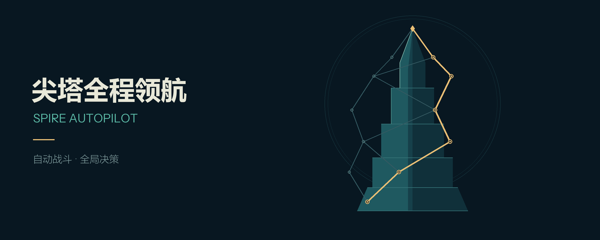



# 尖塔全程领航 · SpireAutopilot

让《杀戮尖塔 2》的单人爬塔自动进行。CombatSolver 负责战斗，模型负责地图路线、事件、奖励、商店、休息与选牌；每局结束后更新一份持续积累的经验总结。

[订阅创意工坊](https://steamcommunity.com/sharedfiles/filedetails/?id=3839527748) · [下载发布版](https://github.com/ydxfkbg1630/SpireAutopilot/releases) · [更新记录](CHANGELOG.md)

## 开始使用

当前适配游戏 **v0.113.0**、**CombatSolver 0.51.5** 与 **RitsuLib 0.6.11+**，面向 Windows 单人游戏。

1. 订阅并启用 CombatSolver、RitsuLib 和本模组。手动安装时，将发布包中的 `SpireAutopilot` 文件夹放入游戏的 `mods/`。
2. 按 **F8** 打开设置，在「模型」页填写接口地址、模型 ID 和 API Key，选择服务支持的协议。
3. 点击「测试连接」，连接成功后点击「保存设置」。
4. 开始或继续单人游戏。领航启动时默认开启，可随时按 **F9** 暂停或继续。

需要一个可用的 OpenAI 兼容模型服务；模型调用费用由所选服务商计收。支持 Responses 与 Chat Completions，地址可填写服务根地址或完整接口地址。

## 领航与显示

| 按键 | 功能 |
| --- | --- |
| **F8** | 打开或收起设置 |
| **F9** | 暂停或继续领航 |
| **F10** | 显示或隐藏直播窗 |

直播窗仅显示当前决策、搜索或出牌进度，拖动标题即可移动。领航期间统一使用本模组界面。

模型选牌时，直播窗先展示牌名、简短理由和倒计时，默认 3 秒后执行。按 **F8** →「直播」→「选牌预览（秒）」可设为 0–10 秒，0 秒为立即执行。

模型直接读取游戏状态并执行游戏动作，支持地图、事件、奖励、商店、休息、选牌和宝箱等场景。地图决策结合整层路线规划；卡牌选择结合牌组、角色状态、遗物和当前位置。战斗由 CombatSolver 独立负责。

## 经验与策略

在 F8 设置中填写策略偏好，指导局外决策。每局结算后，模型结合本局结果修订同一份 `experience.md`，供后续游戏参考。

「模型」页提供「每局更新经验总结」「决策时参考经验」开关，以及「打开经验目录」按钮。经验更新也会产生模型调用。

## 求解器设置

F8 →「求解器」集中管理 CombatSolver 参数，可按名称或分类查找。搜索时间、节点数、束宽与线程预算可按设备和等待偏好调整。

点击「应用设置」后，参数随下一次搜索生效；「重新读取」加载已保存值，「恢复默认」恢复求解器默认值。运行时 GC 设置随下次启动生效。

## 数据与支持

API Key 使用当前 Windows 账户加密保存。配置和经验保存在游戏用户数据目录，个人接口信息由玩家在本地填写。

遇到兼容或运行问题，可在 [GitHub Issues](https://github.com/ydxfkbg1630/SpireAutopilot/issues) 提交游戏与模组版本、复现步骤和脱敏错误摘要。

开发、构建与测试见 [开发指南](docs/DEVELOPMENT.md)。参与贡献与安全反馈见 [CONTRIBUTING.md](CONTRIBUTING.md) 和 [SECURITY.md](SECURITY.md)。

原创代码采用 [Apache-2.0](LICENSE) 许可。游戏、CombatSolver、RitsuLib、FoolSolverCompat、Godot 与 Harmony 遵循各自许可，署名见 [NOTICE](NOTICE)。
